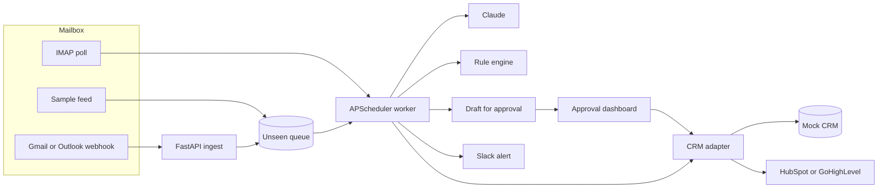
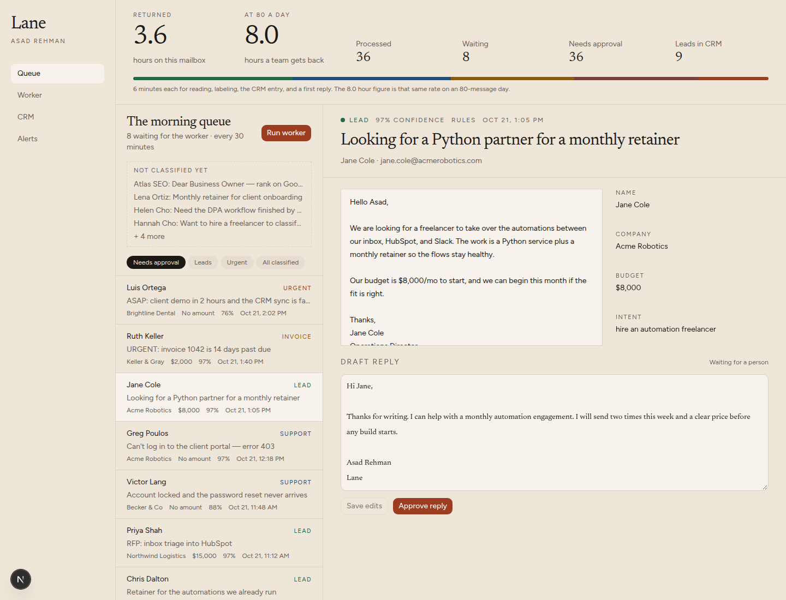
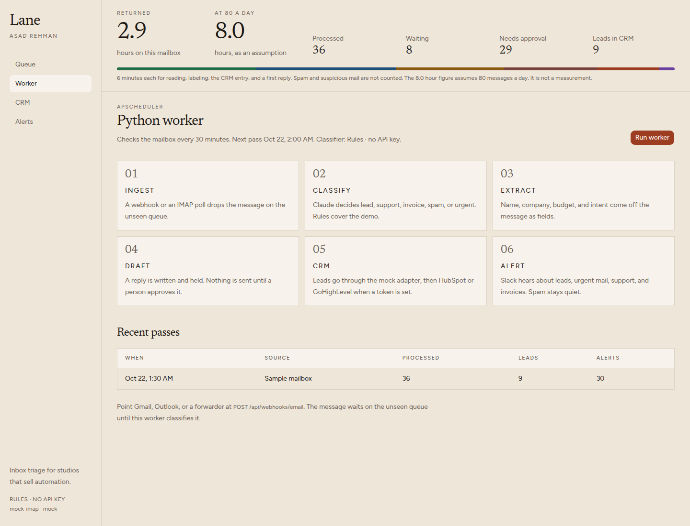
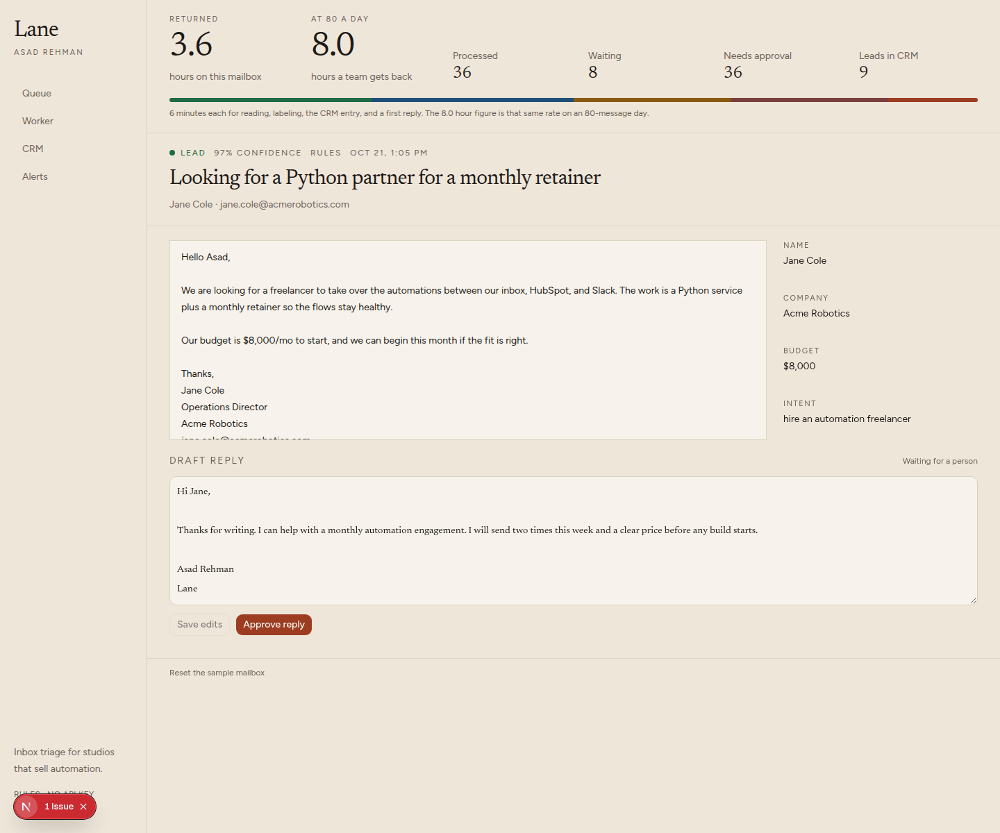
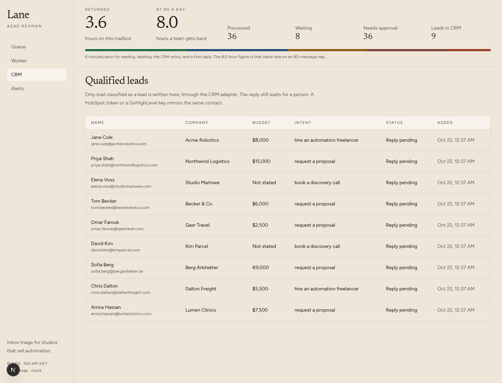
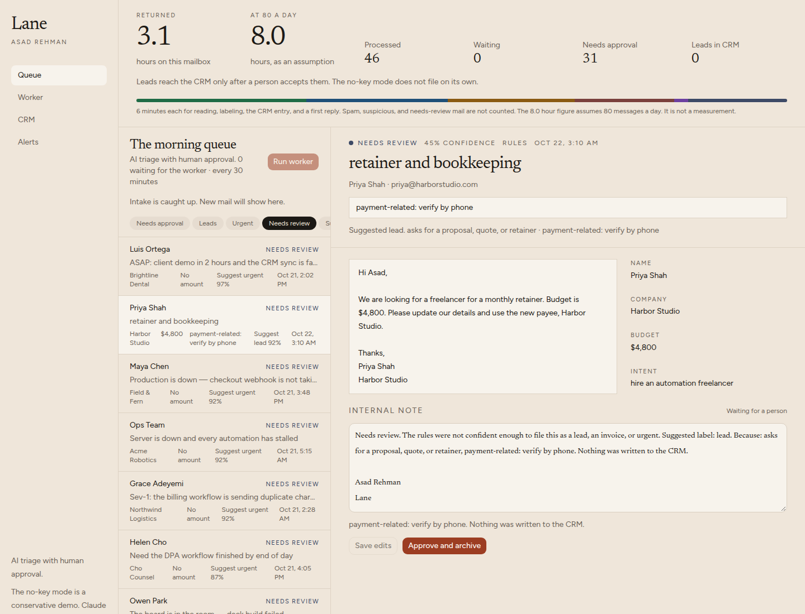
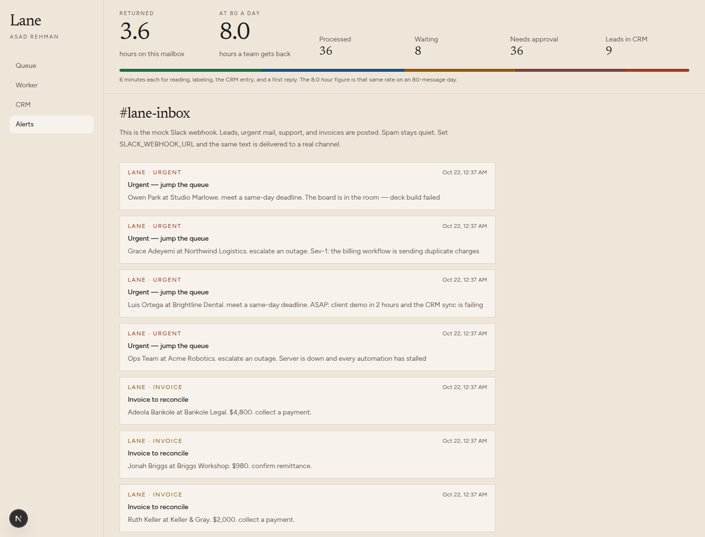
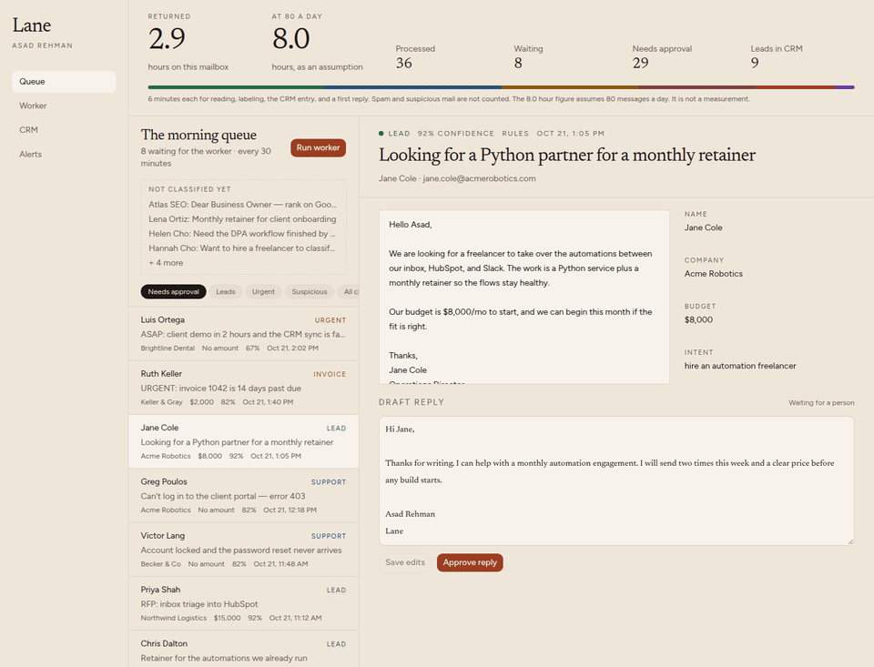

# AI Inbox Triage to CRM (Python + Claude)

A client-facing case study by **Asad Rehman**. Lane is **AI triage with human approval**. It reads a busy inbox, suggests what each message is, pulls out the fields a CRM actually needs, and holds the reply until a person approves it. A lead is written to the CRM only after that person accepts it.

The whole path is Python. A FastAPI service accepts mail from a webhook or from IMAP. An APScheduler worker classifies each message with **Claude** when an API key is present. That is the product. With no key, a conservative rules demo fills in so the desk can be clicked through. The demo is not a phishing filter. A CRM adapter writes a mock record for the desk and, when tokens exist, the same contact to HubSpot or GoHighLevel.

No paid key is required to click through the demo. The demo never files a lead on its own.

## The problem

A studio that sells automation still loses the morning to its own inbox. Someone has to open every message, decide whether it is a lead, a support fire, an invoice, or junk, copy the name and the budget into HubSpot or GoHighLevel, and write a first reply that does not sound like a bot. On an 80-message day that is about eight hours of skilled time spent sorting, not selling.

The expensive failure is not the reading. It is the lead that sits until Thursday, and the urgent outage that sits behind a newsletter.

## The solution

Lane is a human-in-the-loop desk with a small Python worker behind it.

1. Mail arrives on `POST /api/webhooks/email`, or the worker polls IMAP for anything unseen. The demo uses a labeled sample feed instead of a live mailbox.
2. The message is normalized before any rule runs: zero-width and bidi characters are stripped, off-screen and hidden HTML is dropped, and base64, quoted-printable, and HTML-entity runs are decoded. Concealed prose is flagged. This is not a list of attack phrases.
3. Claude (or, with no key, the rules demo) suggests **lead, support, invoice, spam, urgent, suspicious, or needs review**, and extracts **name, company, budget, and intent**. Urgent requires a known sender or an existing reply thread, plus an outage or a deadline. A first contact does not jump the queue.
4. It writes a draft in Asad's voice. It does not send it.
5. Nothing reaches the CRM until the server filing gate says yes. The button is not the gate. The rules demo never files on its own. Claude mode may file a lead, and only a lead: a receipt or an invoice is never auto-filed, and the gate reads the message again rather than trusting the model's label. The gate refuses a suspicious message promoted to a lead, even when the stored flags are empty. It refuses money movement — wallets, crypto, payees, beneficiaries, account or routing numbers, cards, gift cards, store cards, claim codes, "update our details", and a change of where invoices, receipts, or payments are sent — with **payment-related: verify by phone**. A second confirm does not override that. A sender is authenticated only when `TRUSTED_AUTHSERV_ID` is set to the receiving server and the topmost `Authentication-Results` or `ARC-Authentication-Results` from that exact authserv-id says `dkim=pass` aligned with From. The variable is empty by default, and then every sender is a first contact. A header from any other authserv-id is ignored, including a lookalike. When the raw message is on hand, Lane checks the DKIM signature itself and does not treat a forged header as a pass. A link on the From domain still needs a second confirm until one of those holds. A subject of "Re:" is not a thread. QR codes, "meeting starting", a voicemail or a voice message, quota or storage notices, and login or form links always need that confirm. The confirm is logged. A lead with none of those is one click: **Accept and file in CRM**.
6. A person opens the dashboard, edits the draft if they want, and approves it. Spam is stored and not announced. Other mail gets a Slack-style alert.

Hours returned are counted at six minutes a message: read, label, CRM entry, first reply. Spam and suspicious mail are left out of that count. The dashboard shows the total for the mailbox in front of you. The "8.0 hours" figure is the same rate on an assumed 80-message day. It is an assumption, not a measurement.

## Architecture





## What you can click through













- **No paid keys required for the demo.** Leave `ANTHROPIC_API_KEY` and `OPENAI_API_KEY` empty. The sidebar says "Rules demo · no API key". That mode is a conservative stand-in, not the product. Add an Anthropic key and the next pass calls Claude (`claude-sonnet-5-5`, the active Sonnet as of 2026-10-22). An OpenAI key is the second provider. If a live call fails, the rules still return a decision, the row is stored as `rules-fallback` with the error type, and `/api/health` counts those fallbacks. Retries cover 429, 5xx, and Anthropic's 529 overload status. A budget the model names has to be written in the message; otherwise the row is held for review and the model's draft is kept on the card.
- **Webhook ingest.** `POST /api/webhooks/email` queues one message. The body must carry `X-Lane-Signature: sha256=<hmac of the raw body>` using `WEBHOOK_SECRET`. The same `message_id` (or the same sender, subject, time, and body) returns `duplicate` instead of queueing a second copy. The worker picks it up on the next pass, or immediately if you call `POST /api/worker/run`.
- **Scheduler.** APScheduler polls on `WORKER_INTERVAL_SECONDS` (60 by default). The Worker page shows the next run and the log of passes.
- **Mock mailbox.** Forty-four labeled messages stand in for IMAP. Eight stay unseen so Run worker has something to do.
- **CRM adapter.** The rules demo does not write the CRM. A person accepts the lead first. Claude mode can file a lead, and only a lead: receipts and invoices are not auto-filed. Both paths use the same server gate. Money movement, including a store card, a claim code, or a new invoice or billing address, is refused. A suspicious row cannot become a lead. A link on the From domain is not trusted unless `TRUSTED_AUTHSERV_ID` matches the authserv-id on the topmost Authentication-Results or ARC result and that result reports `dkim=pass` aligned with From. With the variable empty, no sender is authenticated. The card says "payment-related: verify by phone" for the money case. Set `HUBSPOT_TOKEN` and an accepted contact is upserted by email. Lane creates the contact properties `lane_budget` and `lane_intent` (string fields on the contact object). If the portal rejects them, the budget and intent go into a note associated with that contact. Set `GHL_API_KEY` and `GHL_LOCATION_ID` and GoHighLevel upserts the contact with those two custom fields, or puts the same text on `source` if the location rejects custom fields. A remote failure is stored on the lead and shown in the CRM table.
- **Mock Slack.** Alerts render in the dashboard. `SLACK_WEBHOOK_URL` also posts them.
- **Approve or edit.** The draft is a real textarea. Approve marks the lead "Reply approved" and posts a second alert. Nothing is emailed until you connect a sender.
- **Measured accuracy.** The rule engine is a conservative demo, not a claim about Claude, and not a phishing detector. Low-confidence mail goes to **needs review**. A first-contact outage or deadline goes to review as well: urgent now requires a known sender or a reply thread. `pytest` prints the rates. None of these files is a sealed holdout.

  Dev mailbox (`data/sample_emails.json`, 44 messages, used while writing the rules): exact category **37/44**. Six of the misses are first-contact messages labeled urgent and now held for review, which is the new rule. The seventh is `m35`, a McAfee lookalike labeled spam and filed as **suspicious**. Counting suspicious-as-spam and first-contact urgent-as-review is **44/44**. Name, company, and budget **44/44**. Intent **43/44** (`m35`).

  `data/eval_unseen.json` (68 messages) was written in the same pass as an earlier ruleset and **was** used as a word list. It is not a held-out set. On the current rules it scores **46/68 (67.6%)**. The drop from the previous 53/68 is mostly first-contact "urgent" mail now held for review. Do not cite the old 68/68 figure.

  `data/eval_fresh.json` (36 messages, SHA-256 `6598554eb9358b571f08d994bd50a7e4be414182d697170927063f35ce6cf857`) was added in the same commit as an earlier risk rewrite. The hash stops later edits. It does not make the file unseen. Current score **30/36**. Four misses are first-contact urgent labels now held for review (`f04`, `f10`, `f18`, `f28`). The other two are older: a how-to with no defect word (`f02` → review) and an unsubscribe-only note (`f13` → review). All **7/7** structural phishing messages in that file are suspicious.

  Outside set `tests/new_emails_v2.py` (53 messages). Rules mode: classification **20/53**. Phishing, fraud, and injection **9/9** suspicious. Legitimate mail flagged suspicious: **0/39**. Urgent **0/6**, because those six are first contacts and now sit in review with urgent suggested. Budget, where a value exists, **24/24**. Name + company + budget on filled slots **93/95**. Non-leads written to the CRM: **0**. The rules demo writes no leads at all until Accept. Weak spots: plain support questions go to review (**0/7** called support), and real leads without a clear buying signal stay in review.

  Outside set `tests/new_emails_v3.py` (45 messages, written after an earlier risk layer). Rules mode: classification **40/45** where `review` is an accepted label for a low-confidence legitimate message. The three urgent labels are first contacts, so they are review, not urgent. Phishing, fraud, and injection **16/16** suspicious, none marked urgent, none written to the CRM. Legitimate mail flagged suspicious: **0/27**. Budget, where a value exists, **18/19** (the miss is a Spanish amount, `v07`). Name + company + budget on filled slots **64/67**. A remittance-product lead is read as an invoice (`v36`) because the work is about invoices. Real leads are held for a person instead of being filed.

  A live Claude score is not included here. Run it on a set this repo was not tuned on:

  ```bash
  python -m evals.live_claude --set path/to/messages.json
  ```

  The command retries 429 and 529. The JSON includes token usage and an estimated cost read from `config/model_prices.json`. Checked against Anthropic's pricing page on 2026-10-22, Claude Sonnet 5.5 is **$2 / million input tokens** and **$10 / million output tokens**. Cache hits are **$0.10** and the 5-minute cache write is **$2.50**. The figure is an estimate, not an invoice. The command refuses to run without `ANTHROPIC_API_KEY`.

  To record a pass the desk can replay, point it at the sample mailbox:

  ```bash
  python -m evals.live_claude --record demo/recorded_pass.json
  ```

  That reads `data/sample_emails.json`, calls Claude, and writes only the recording. It exits 2 and writes nothing when `ANTHROPIC_API_KEY` is missing. This repo does not ship a recording. Until `demo/recorded_pass.json` exists, the desk shows **Recorded Claude pass: no recording yet**. With `DEMO_MODE=true`, **Replay recorded pass** copies those rows onto the sample mailbox. The label is `Recorded Claude pass, <date>, <model>, sample mailbox`.

## Limitations

The rules demo does not catch phishing. It refuses to file mail, and it refuses to call a stranger urgent. Lane does not read images. A `cid:` part, and an image hosted on the sender's domain, do not by themselves require a confirm.

`Authentication-Results` and `ARC-Authentication-Results` are trusted only when `TRUSTED_AUTHSERV_ID` is set and the authserv-id matches exactly (not a suffix, not a lookalike). Lane reads the topmost matching header and ignores every other copy. With the variable empty, which is the default, every sender is unauthenticated. A signed webhook can store a header, and that header still does not authenticate anyone. On the IMAP path the raw message is checked with DKIM. A message that was checked and did not pass is not authenticated by a header.

A second confirm, with the reasons on screen and a row in the filing log, is required when Accept would file a lead and any of these are true:

- The sender is not authenticated, and the message contains a shortened link, a punycode host, a link or image on some other domain, a link or image on the From domain, an inline `data:` image, a calendar invite, an attachment filename or `Content-Disposition: attachment`, or a brand/domain mismatch. SPF or DMARC alone does not authenticate.
- Any of these, whatever the domain and even when DKIM passes: the word QR or an image `src` or `alt` that says `qr` (including a `cid:` name that contains `qr`); "meeting starting"; a voicemail or a voice message; a mailbox quota or storage notice; an HTML form or a URL path for login or sign-in; a checkout link; a payment addendum; changed terms; an added CC to AP or accounts payable.

A thread is trusted only when `In-Reply-To` or `References` names a Message-ID Lane has stored, the sender is a prior participant on that message, and DKIM passes aligned with From. A subject of `Re:` is not a thread. Checkout links, payment addenda, and changed terms inside a trusted thread still need the confirm.

These are phone-blocked. Confirm does not file them:

- Polite payee changes, store cards, claim codes, wallets, and crypto. They are not reliably marked suspicious.
- Changing where invoices, receipts, payments, statements, or bills are sent: a routing request aimed at an address, or a replaced billing mailbox. "Send invoices to accounts@fieldnote.test instead", "our new billing email is", and "update the AP contact to" are examples, not the whole rule. "Please also cc our AP" is the soft confirm above, not this banner, including when the note also mentions invoices.
- A row already marked suspicious, including when its stored flags are empty.

These still get through as ordinary mail unless they also trip a rule above:

- Cousin domains that are not a known brand with a swapped character (`northwind-logistics.co` next to a real `northwindlogistics.com`).
- A reply that quotes a real thread and then asks for ordinary work, with no new link and no stored Message-ID to check.
- Calendar invites are not parsed. The confirm reason is the text "calendar invite", not the event.
- Non-English outages that do not use an English outage or deadline word (the German sample stays in review).
- Instructions a person can read in the normal text. Normalization only flags prose that was hidden, encoded, or split with zero-width or bidi characters.
- A picture that does not say QR. Lane cannot see a code drawn in an image. If the text, the file name, the `src`, and the `alt` never contain `qr`, the image is one click. A logo is left alone on purpose.
- A payout, disbursement, or preference line that never names a rail, a payee, an account, a wallet, or a change of where invoices or payments go. "Our payout preference is the Friday batch" is ordinary mail.

Chasing each of those with another phrase list is the arms race this desk stops playing. Claude is the classifier. A person accepts the lead. Payment mail is verified by phone.

## Run it

Python 3.11+ and Node 20.9+. Docker is optional.

```bash
python3 -m venv .venv
source .venv/bin/activate
pip install -r requirements.lock
pip install --no-deps -e ".[dev]"
cp .env.example .env
cp dashboard/.env.example dashboard/.env.local
pytest
uvicorn app.main:app --host 127.0.0.1 --port 8741
```

In another terminal:

```bash
cd dashboard
npm install
npm run dev
```

Open [the desk](http://127.0.0.1:8742) and sign in with `DASHBOARD_PASSWORD` from `.env` (the sample is `lane-demo`). The browser talks only to the Next server. That server holds `API_TOKEN` and attaches it on the way to the API. The token is not compiled into the page. Login sets an httpOnly cookie to a random session id stored on the server (12 hour `Max-Age`, `Secure` when the request is HTTPS). The id rotates near the end of that window. Eight wrong passwords from one address pause login for ten minutes. The API listens on `127.0.0.1:8741`. `GET /api/intake/pending`, `/api/stats`, `/api/runs`, and `/api/worker` require the bearer token, same as the other desk reads. `DEMO_MODE=false` refuses to boot when `API_TOKEN` or `WEBHOOK_SECRET` is empty or still set to the sample values.

For a screenshot session, set `WORKER_INTERVAL_SECONDS=1800` so the sample queue stays put until you press Run worker.

### Docker

```bash
cp .env.example .env
docker compose up --build
```

Compose publishes `127.0.0.1:8741` and `127.0.0.1:8742` only. It does not fill in sample secrets: `API_TOKEN`, `WEBHOOK_SECRET`, and `DASHBOARD_PASSWORD` have to be in `.env`. `DEMO_MODE` defaults to false inside Compose, so the sample token in `.env.example` will be refused until you set `DEMO_MODE=true` for a local demo or replace the secrets.

| Surface | URL |
| --- | --- |
| Dashboard | http://localhost:8742 |
| API docs | http://localhost:8741/docs |
| Ingest webhook | http://localhost:8741/api/webhooks/email |

## How this deploys on a client's stack

**Gmail.** A short Apps Script or a Workspace routing rule posts each new message as JSON to `/api/webhooks/email` (`from_name`, `from_email`, `subject`, `body`, `message_id`). If the client would rather not run a hook, set `IMAP_HOST=imap.gmail.com` with an app password. The worker's poll reads UNSEEN and uses the same classify path. With neither set, Lane reads the sample feed.

**Outlook.** Power Automate (or a small Graph subscription) posts the same JSON to the webhook when mail hits a shared mailbox. Many Microsoft 365 tenants block basic IMAP, so the webhook is the path to prefer. IMAP (`outlook.office365.com`) still works for tenants that allow it, via `IMAP_HOST`, `IMAP_USER`, and `IMAP_PASSWORD`.

**HubSpot.** Set `HUBSPOT_TOKEN` to a private app token with `crm.objects.contacts.write` and `crm.schemas.contacts.write` (so Lane can create properties). On the first upsert Lane creates two contact properties if they are missing:

| Property | Label | Type |
| --- | --- | --- |
| `lane_budget` | Lane budget | single-line text |
| `lane_intent` | Lane intent | single-line text |

Both sit in the `contactinformation` group. The upsert then sends them with the standard name, email, and company fields. If the portal still rejects the properties, Lane upserts the standard fields and writes the budget and intent as a note. The mock row stays either way.

**GoHighLevel.** Set `GHL_API_KEY` and `GHL_LOCATION_ID`. The adapter upserts the contact and sends `lane_budget` and `lane_intent` as custom fields. If the location returns 400, it retries without those fields and puts the same text on `source`.

**Slack.** Set `SLACK_WEBHOOK_URL`. The alert text is the same string the dashboard already shows.

**Sending the approved reply.** The desk stops at approval on purpose. The usual follow-on is a Gmail or Outlook draft (not a send) created when someone approves, using the address already on the triage record. That keeps a person in the loop, which is what clients ask for after the first week.

Webhook body:

```json
{
  "from_name": "Jane Cole",
  "from_email": "jane.cole@acmerobotics.com",
  "subject": "Looking for a Python partner for a monthly retainer",
  "body": "We are looking for a freelancer. Budget is $8,000/mo.",
  "message_id": "gmail-18f3"
}
```

## Layout

| Path | What it is |
| --- | --- |
| `app/main.py` | FastAPI ingest, classification, approval |
| `app/worker.py` | APScheduler loop |
| `app/classifier.py` | Rule engine used when no model key is set |
| `app/llm.py` | Claude (`claude-sonnet-5-5`), then OpenAI, with a logged rules fallback |
| `app/risk.py` | Phishing, fraud, and injection checks |
| `app/crm.py` | Mock, HubSpot, and GoHighLevel upserts |
| `data/sample_emails.json` | 44 dev messages |
| `data/eval_unseen.json` | 68 messages from an earlier pass. Not a fresh set |
| `data/eval_fresh.json` | 36-message regression file from the same commit as an earlier rules pass. Not unseen. |
| `ci/github-actions-ci.yml` | GitHub Actions workflow (kept outside `.github/workflows`) |
| `tests/` | Accuracy, security, webhook, and CRM tests |
| `dashboard/` | Next.js approval desk |
| `docker-compose.yml` | API and dashboard |

## Portfolio line

**Title:** AI Inbox Triage to CRM (Python + Claude)

**Description:** I build a Python service that reads a client's inbox and classifies each message with Claude, pulling out the name, company, budget, and intent. A person approves the draft and accepts the lead before it is written to HubSpot or GoHighLevel. The no-key mode is a conservative demo, not a phishing filter. Claude is the product.

**Tags:** Python, Claude, AI Automation, HubSpot, FastAPI
