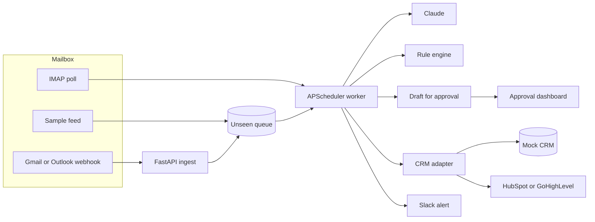

# AI Inbox Triage to CRM (Python + Claude)

A client-facing case study by **Asad Rehman**. Lane reads a busy inbox, decides what each message is, pulls out the fields a CRM actually needs, and holds a reply until a person approves it. Qualified leads land in the CRM. Everyone else gets a Slack-style alert. Spam stays quiet.

The whole path is Python. A FastAPI service accepts mail from a webhook or from IMAP. An APScheduler worker classifies each message with **Claude** when an API key is present, and with a built-in rule engine when it is not. A CRM adapter writes a mock record for the desk and, when tokens exist, the same contact to HubSpot or GoHighLevel.

No paid key is required to click through the demo.

## The problem

A studio that sells automation still loses the morning to its own inbox. Someone has to open every message, decide whether it is a lead, a support fire, an invoice, or junk, copy the name and the budget into HubSpot or GoHighLevel, and write a first reply that does not sound like a bot. On an 80-message day that is about eight hours of skilled time spent sorting, not selling.

The expensive failure is not the reading. It is the lead that sits until Thursday, and the urgent outage that sits behind a newsletter.

## The solution

Lane is a human-in-the-loop desk with a small Python worker behind it.

1. Mail arrives on `POST /api/webhooks/email`, or the worker polls IMAP for anything unseen. The demo uses a labeled sample feed instead of a live mailbox.
2. The worker asks Claude (or the rule engine) to classify the message as **lead, support, invoice, spam, or urgent**, and to extract **name, company, budget, and intent**.
3. It writes a draft in Asad's voice. It does not send it.
4. If the message is a lead, the CRM adapter creates the contact and the worker posts a Slack-style alert. Support, invoices, and urgent mail are alerted and queued. Spam is stored and not announced.
5. A person opens the dashboard, edits the draft if they want, and approves it.

Hours returned are counted at six minutes a message: read, label, CRM entry, first reply. The dashboard shows that total for the mailbox in front of you, and the same rate projected onto an 80-message day.

## Architecture




## What you can click through


- **No paid keys required.** Leave `ANTHROPIC_API_KEY` and `OPENAI_API_KEY` empty. Classification, extraction, and drafts use the rule engine. Add an Anthropic key and the next pass calls Claude. An OpenAI key is the fallback model. If a live call fails, the rules still return a decision.
- **Webhook ingest.** `POST /api/webhooks/email` queues one message. The worker picks it up on the next pass, or immediately if you call `POST /api/worker/run`.
- **Scheduler.** APScheduler polls on `WORKER_INTERVAL_SECONDS` (60 by default). The Worker page shows the next run and the log of passes.
- **Mock mailbox.** Forty-four labeled messages stand in for IMAP. Eight stay unseen so Run worker has something to do.
- **CRM adapter.** Every lead is written to the mock CRM the dashboard reads. Set `HUBSPOT_TOKEN` and the same contact is created in HubSpot. Set `GHL_API_KEY` and `GHL_LOCATION_ID` for GoHighLevel.
- **Mock Slack.** Alerts render in the dashboard. `SLACK_WEBHOOK_URL` also posts them.
- **Approve or edit.** The draft is a real textarea. Approve marks the lead "Reply approved" and posts a second alert. Nothing is emailed until you connect a sender.
- **Measured accuracy.** `pytest` scores the rule engine on the labeled set and prints classification and field accuracy.

## Run it

Python 3.11+ and Node 20.9+. Docker is optional.

```bash
python3 -m venv .venv
source .venv/bin/activate
pip install -e ".[dev]"
pytest
uvicorn app.main:app --host 0.0.0.0 --port 8741
```

In another terminal:

```bash
cd dashboard
npm install
npm run dev
```

Open [the desk](http://127.0.0.1:8742). The API is on port 8741. Copy `.env.example` to `.env` when you want to drop in a Claude key or a CRM token.

For a screenshot session, set `WORKER_INTERVAL_SECONDS=300` so the sample queue stays put until you press Run worker.

### Docker

```bash
docker compose up --build
```

| Surface | URL |
| --- | --- |
| Dashboard | http://localhost:8742 |
| API docs | http://localhost:8741/docs |
| Ingest webhook | http://localhost:8741/api/webhooks/email |

## How this deploys on a client's stack

**Gmail.** A short Apps Script or a Workspace routing rule posts each new message as JSON to `/api/webhooks/email` (`from_name`, `from_email`, `subject`, `body`, `message_id`). If the client would rather not run a hook, set `IMAP_HOST=imap.gmail.com` with an app password. The worker's poll reads UNSEEN and uses the same classify path. With neither set, Lane reads the sample feed.

**Outlook.** Power Automate (or a small Graph subscription) posts the same JSON to the webhook when mail hits a shared mailbox. Many Microsoft 365 tenants block basic IMAP, so the webhook is the path to prefer. IMAP (`outlook.office365.com`) still works for tenants that allow it, via `IMAP_HOST`, `IMAP_USER`, and `IMAP_PASSWORD`.

**HubSpot.** Set `HUBSPOT_TOKEN` to a private app token with `crm.objects.contacts.write`. The HubSpot adapter creates the contact with email, first name, last name, company, and lifecycle stage `lead`. The mock row stays, so the desk and the CRM do not drift during a rollout.

**GoHighLevel.** Set `GHL_API_KEY` and `GHL_LOCATION_ID`. The adapter posts the contact to LeadConnector with the source `Lane inbox triage`.

**Slack.** Set `SLACK_WEBHOOK_URL`. The alert text is the same string the dashboard already shows.

**Sending the approved reply.** The desk stops at approval on purpose. The usual follow-on is a Gmail or Outlook draft (not a send) created when someone approves, using the address already on the triage record. That keeps a person in the loop, which is what clients ask for after the first week.

Webhook body:

```json
{
  "from_name": "Jane Cole",
  "from_email": "jane.cole@acmerobotics.com",
  "subject": "Looking for a Python partner for a monthly retainer",
  "body": "We are looking for a freelancer. Budget is $8,000/mo.",
  "message_id": "gmail-18f3"
}
```

## Layout

| Path | What it is |
| --- | --- |
| `app/main.py` | FastAPI ingest, classification, approval |
| `app/worker.py` | APScheduler loop |
| `app/classifier.py` | Rule engine used when no model key is set |
| `app/llm.py` | Claude, then OpenAI, with a rule fallback |
| `app/crm.py` | Mock, HubSpot, and GoHighLevel adapters |
| `data/sample_emails.json` | 44 labeled messages |
| `tests/` | Accuracy, webhook, and CRM tests |
| `dashboard/` | Next.js approval desk |
| `docker-compose.yml` | API and dashboard |

## Portfolio line

**Title:** AI Inbox Triage to CRM (Python + Claude)

**Description:** I build a Python service that reads a client's inbox, classifies each message with Claude, and pulls out the name, company, budget, and intent. A worker files qualified leads in HubSpot or GoHighLevel and drafts a reply for a person to approve. It runs with no API key in the demo, so the desk can be reviewed before Claude is turned on.

**Tags:** Python, Claude, AI Automation, HubSpot, FastAPI
