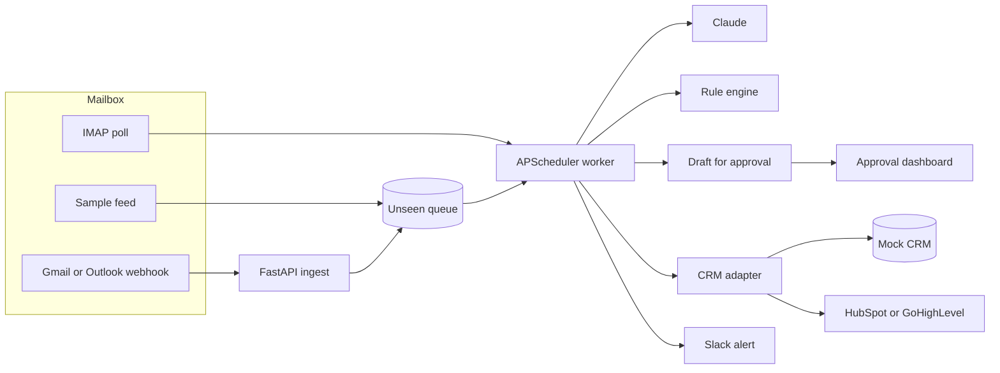

# AI Inbox Triage to CRM (Python + Claude)

A client-facing case study by **Asad Rehman**. Lane reads a busy inbox, decides what each message is, pulls out the fields a CRM actually needs, and holds a reply until a person approves it. Qualified leads land in the CRM. Everyone else gets a Slack-style alert. Spam stays quiet.

The whole path is Python. A FastAPI service accepts mail from a webhook or from IMAP. An APScheduler worker classifies each message with **Claude** when an API key is present, and with a built-in rule engine when it is not. A CRM adapter writes a mock record for the desk and, when tokens exist, the same contact to HubSpot or GoHighLevel.

No paid key is required to click through the demo.

## The problem

A studio that sells automation still loses the morning to its own inbox. Someone has to open every message, decide whether it is a lead, a support fire, an invoice, or junk, copy the name and the budget into HubSpot or GoHighLevel, and write a first reply that does not sound like a bot. On an 80-message day that is about eight hours of skilled time spent sorting, not selling.

The expensive failure is not the reading. It is the lead that sits until Thursday, and the urgent outage that sits behind a newsletter.

## The solution

Lane is a human-in-the-loop desk with a small Python worker behind it.

1. Mail arrives on `POST /api/webhooks/email`, or the worker polls IMAP for anything unseen. The demo uses a labeled sample feed instead of a live mailbox.
2. A security check runs first. Phishing, a bank-change request, or a prompt injection is marked **suspicious**, skipped by the model, and not written to the CRM.
3. The worker asks Claude (or the rule engine) to classify the message as **lead, support, invoice, spam, urgent, or suspicious**, and to extract **name, company, budget, and intent**.
4. It writes a draft in Asad's voice. It does not send it. A suspicious message gets a "do not reply" note instead.
5. If the message is a lead, the CRM adapter upserts the contact and the worker posts a Slack-style alert. Support, invoices, urgent, and suspicious mail are alerted and queued. Spam is stored and not announced.
6. A person opens the dashboard, edits the draft if they want, and approves it.

Hours returned are counted at six minutes a message: read, label, CRM entry, first reply. Spam and suspicious mail are left out of that count. The dashboard shows the total for the mailbox in front of you. The "8.0 hours" figure is the same rate on an assumed 80-message day. It is an assumption, not a measurement.

## Architecture




## What you can click through


- **No paid keys required.** Leave `ANTHROPIC_API_KEY` and `OPENAI_API_KEY` empty. Classification, extraction, and drafts use the rule engine, and the sidebar says so. Add an Anthropic key and the next pass calls Claude (`claude-sonnet-5-5`, the active Sonnet as of 2026-10-22). An OpenAI key is the second provider. If a live call fails, the rules still return a decision, the row is stored as `rules-fallback` with the error type, and `/api/health` counts those fallbacks.
- **Webhook ingest.** `POST /api/webhooks/email` queues one message. The body must carry `X-Lane-Signature: sha256=<hmac of the raw body>` using `WEBHOOK_SECRET`. The same `message_id` (or the same sender, subject, time, and body) returns `duplicate` instead of queueing a second copy. The worker picks it up on the next pass, or immediately if you call `POST /api/worker/run`.
- **Scheduler.** APScheduler polls on `WORKER_INTERVAL_SECONDS` (60 by default). The Worker page shows the next run and the log of passes.
- **Mock mailbox.** Forty-four labeled messages stand in for IMAP. Eight stay unseen so Run worker has something to do.
- **CRM adapter.** Every lead is written to the mock CRM the dashboard reads. Set `HUBSPOT_TOKEN` and the same contact is upserted in HubSpot by email, including `lane_budget` and `lane_intent`. Set `GHL_API_KEY` and `GHL_LOCATION_ID` and GoHighLevel upserts the contact. A remote failure is stored on the lead and shown in the CRM table.
- **Mock Slack.** Alerts render in the dashboard. `SLACK_WEBHOOK_URL` also posts them.
- **Approve or edit.** The draft is a real textarea. Approve marks the lead "Reply approved" and posts a second alert. Nothing is emailed until you connect a sender.
- **Measured accuracy.** The numbers below are from the rule engine, which is what runs when no key is set. They are not a Claude score. `pytest` prints both sets.

  The dev mailbox (`data/sample_emails.json`, 44 messages) was used while the rules were written. Exact category match is **43/44**. The miss is `m35`, a McAfee lookalike labeled spam and filed as **suspicious**, which is the review state we want. Counting that as a correct spam decision is **44/44**. Name, company, and budget match **44/44**. Intent matches **43/44** (`m35` is "review a suspicious message" rather than "unsolicited promotion").

  The held-out file (`data/eval_unseen.json`, 68 messages: 36 from an outside review plus 32 more frozen in the same pass) was not used as a word list. Classification is **68/68**, where a suspicious decision counts as a hit on a spam label. On slots that have a name, company, or budget, the value matches **127/127**. On slots that are empty, the engine invented a value **0/77** times. Intent is not in that headline. A range such as `£15,000–£20,000` counts as correct when the labeled amount sits inside it.

## Run it

Python 3.11+ and Node 20.9+. Docker is optional.

```bash
python3 -m venv .venv
source .venv/bin/activate
pip install -r requirements.lock
pip install --no-deps -e ".[dev]"
cp .env.example .env
cp dashboard/.env.example dashboard/.env.local
pytest
uvicorn app.main:app --host 127.0.0.1 --port 8741
```

In another terminal:

```bash
cd dashboard
npm install
npm run dev
```

Open [the desk](http://127.0.0.1:8742). The API listens on `127.0.0.1:8741`. Mutations and the desk reads send `Authorization: Bearer $API_TOKEN`. The sample token in `.env.example` is for a local demo. Change it before you expose the port.

For a screenshot session, set `WORKER_INTERVAL_SECONDS=1800` so the sample queue stays put until you press Run worker.

### Docker

```bash
docker compose up --build
```

| Surface | URL |
| --- | --- |
| Dashboard | http://localhost:8742 |
| API docs | http://localhost:8741/docs |
| Ingest webhook | http://localhost:8741/api/webhooks/email |

## How this deploys on a client's stack

**Gmail.** A short Apps Script or a Workspace routing rule posts each new message as JSON to `/api/webhooks/email` (`from_name`, `from_email`, `subject`, `body`, `message_id`). If the client would rather not run a hook, set `IMAP_HOST=imap.gmail.com` with an app password. The worker's poll reads UNSEEN and uses the same classify path. With neither set, Lane reads the sample feed.

**Outlook.** Power Automate (or a small Graph subscription) posts the same JSON to the webhook when mail hits a shared mailbox. Many Microsoft 365 tenants block basic IMAP, so the webhook is the path to prefer. IMAP (`outlook.office365.com`) still works for tenants that allow it, via `IMAP_HOST`, `IMAP_USER`, and `IMAP_PASSWORD`.

**HubSpot.** Set `HUBSPOT_TOKEN` to a private app token with `crm.objects.contacts.write`. The adapter upserts the contact by email and writes `lane_budget` and `lane_intent` alongside the standard name and company fields. The mock row stays, so the desk and the CRM do not drift during a rollout.

**GoHighLevel.** Set `GHL_API_KEY` and `GHL_LOCATION_ID`. The adapter upserts the contact at LeadConnector with the source `Lane inbox triage`.

**Slack.** Set `SLACK_WEBHOOK_URL`. The alert text is the same string the dashboard already shows.

**Sending the approved reply.** The desk stops at approval on purpose. The usual follow-on is a Gmail or Outlook draft (not a send) created when someone approves, using the address already on the triage record. That keeps a person in the loop, which is what clients ask for after the first week.

Webhook body:

```json
{
  "from_name": "Jane Cole",
  "from_email": "jane.cole@acmerobotics.com",
  "subject": "Looking for a Python partner for a monthly retainer",
  "body": "We are looking for a freelancer. Budget is $8,000/mo.",
  "message_id": "gmail-18f3"
}
```

## Layout

| Path | What it is |
| --- | --- |
| `app/main.py` | FastAPI ingest, classification, approval |
| `app/worker.py` | APScheduler loop |
| `app/classifier.py` | Rule engine used when no model key is set |
| `app/llm.py` | Claude (`claude-sonnet-5-5`), then OpenAI, with a logged rules fallback |
| `app/risk.py` | Phishing, fraud, and injection checks |
| `app/crm.py` | Mock, HubSpot, and GoHighLevel upserts |
| `data/sample_emails.json` | 44 dev messages |
| `data/eval_unseen.json` | 68 frozen held-out messages |
| `tests/` | Accuracy, security, webhook, and CRM tests |
| `dashboard/` | Next.js approval desk |
| `docker-compose.yml` | API and dashboard |

## Portfolio line

**Title:** AI Inbox Triage to CRM (Python + Claude)

**Description:** I build a Python service that reads a client's inbox, classifies each message with Claude, and pulls out the name, company, budget, and intent. A worker files qualified leads in HubSpot or GoHighLevel and drafts a reply for a person to approve. It runs with no API key in the demo, so the desk can be reviewed before Claude is turned on.

**Tags:** Python, Claude, AI Automation, HubSpot, FastAPI
