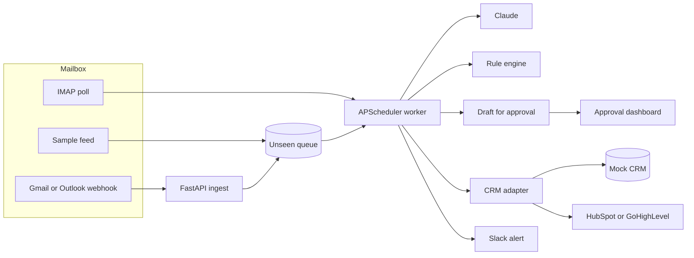

# AI Inbox Triage to CRM (Python + Claude)

A client-facing case study by **Asad Rehman**. Lane reads a busy inbox, decides what each message is, pulls out the fields a CRM actually needs, and holds a reply until a person approves it. Qualified leads land in the CRM. Everyone else gets a Slack-style alert. Spam stays quiet.

The whole path is Python. A FastAPI service accepts mail from a webhook or from IMAP. An APScheduler worker classifies each message with **Claude** when an API key is present, and with a built-in rule engine when it is not. A CRM adapter writes a mock record for the desk and, when tokens exist, the same contact to HubSpot or GoHighLevel.

No paid key is required to click through the demo.

## The problem

A studio that sells automation still loses the morning to its own inbox. Someone has to open every message, decide whether it is a lead, a support fire, an invoice, or junk, copy the name and the budget into HubSpot or GoHighLevel, and write a first reply that does not sound like a bot. On an 80-message day that is about eight hours of skilled time spent sorting, not selling.

The expensive failure is not the reading. It is the lead that sits until Thursday, and the urgent outage that sits behind a newsletter.

## The solution

Lane is a human-in-the-loop desk with a small Python worker behind it.

1. Mail arrives on `POST /api/webhooks/email`, or the worker polls IMAP for anything unseen. The demo uses a labeled sample feed instead of a live mailbox.
2. A security check runs first. Phishing, a bank-change request, or a prompt injection is marked **suspicious**, skipped by the model, and not written to the CRM.
3. The worker asks Claude (or the rule engine) to classify the message as **lead, support, invoice, spam, urgent, or suspicious**, and to extract **name, company, budget, and intent**.
4. It writes a draft in Asad's voice. It does not send it. A suspicious message gets a "do not reply" note instead.
5. If the message is a lead, the CRM adapter upserts the contact and the worker posts a Slack-style alert. Support, invoices, urgent, and suspicious mail are alerted and queued. Spam is stored and not announced.
6. A person opens the dashboard, edits the draft if they want, and approves it.

Hours returned are counted at six minutes a message: read, label, CRM entry, first reply. Spam and suspicious mail are left out of that count. The dashboard shows the total for the mailbox in front of you. The "8.0 hours" figure is the same rate on an assumed 80-message day. It is an assumption, not a measurement.

## Architecture




## What you can click through


- **No paid keys required.** Leave `ANTHROPIC_API_KEY` and `OPENAI_API_KEY` empty. Classification, extraction, and drafts use the rule engine, and the sidebar says so. Add an Anthropic key and the next pass calls Claude (`claude-sonnet-5-5`, the active Sonnet as of 2026-10-22). An OpenAI key is the second provider. If a live call fails, the rules still return a decision, the row is stored as `rules-fallback` with the error type, and `/api/health` counts those fallbacks. Retries cover 429, 5xx, and Anthropic's 529 overload status. A budget the model names has to be written in the message; otherwise the row is held for review and the model's draft is kept on the card.
- **Webhook ingest.** `POST /api/webhooks/email` queues one message. The body must carry `X-Lane-Signature: sha256=<hmac of the raw body>` using `WEBHOOK_SECRET`. The same `message_id` (or the same sender, subject, time, and body) returns `duplicate` instead of queueing a second copy. The worker picks it up on the next pass, or immediately if you call `POST /api/worker/run`.
- **Scheduler.** APScheduler polls on `WORKER_INTERVAL_SECONDS` (60 by default). The Worker page shows the next run and the log of passes.
- **Mock mailbox.** Forty-four labeled messages stand in for IMAP. Eight stay unseen so Run worker has something to do.
- **CRM adapter.** A confident lead is written to the mock CRM the dashboard reads. Suspicious mail, anything held for review, and any request to wire money or change an ACH, routing number, or bank detail are not. A free-mail sender with a price and a payment ask is not filed either. Set `HUBSPOT_TOKEN` and the same contact is upserted by email. Lane creates the contact properties `lane_budget` and `lane_intent` (string fields on the contact object). If the portal rejects them, the budget and intent go into a note associated with that contact. Set `GHL_API_KEY` and `GHL_LOCATION_ID` and GoHighLevel upserts the contact with those two custom fields, or puts the same text on `source` if the location rejects custom fields. A remote failure is stored on the lead and shown in the CRM table.
- **Mock Slack.** Alerts render in the dashboard. `SLACK_WEBHOOK_URL` also posts them.
- **Approve or edit.** The draft is a real textarea. Approve marks the lead "Reply approved" and posts a second alert. Nothing is emailed until you connect a sender.
- **Measured accuracy.** The rule engine is a conservative fallback, not a claim about Claude. Low-confidence mail goes to **needs review** instead of being guessed as a lead, an invoice, or urgent. `pytest` prints the rates.

  Dev mailbox (`data/sample_emails.json`, 44 messages, used while writing the rules): exact category **43/44**. The miss is `m35`, a McAfee lookalike labeled spam and filed as **suspicious**. Counting that as the right spam decision is **44/44**. Name, company, and budget **44/44**. Intent **43/44** (`m35` is "review a suspicious message").

  `data/eval_unseen.json` (68 messages) was written in the same pass as an earlier ruleset and **was** used as a word list. It is not a held-out set. On the current rules it scores **53/68 (77.9%)**. Do not cite the old 68/68 figure.

  `data/eval_fresh.json` (36 messages, SHA-256 `6598554eb9358b571f08d994bd50a7e4be414182d697170927063f35ce6cf857`) was added in the same commit as an earlier risk rewrite. The hash stops later edits. It does not make the file unseen. Treat **34/36** as a regression floor. The two misses are a how-to with no defect word (`f02` → review) and an unsubscribe-only note (`f13` → review). All **7/7** structural phishing messages in that file are suspicious.

  Outside set `tests/new_emails_v2.py` (53 messages). Rules mode: classification **26/53**. Phishing, fraud, and injection **9/9** suspicious. Legitimate mail flagged suspicious: **0/39**. Urgent **6/6**. Budget, where a value exists, **24/24**. Name + company + budget on filled slots **93/95**. Non-leads written to the CRM: **0**. Weak spots: plain support questions go to review (**0/7** called support), and real leads without a clear buying signal stay in review.

  Outside set `tests/new_emails_v3.py` (45 messages, written after the previous risk layer). Rules mode: classification **42/45** where `review` is an accepted label for a low-confidence legitimate message. Phishing, fraud, and injection **16/16** suspicious, none marked urgent, none written to the CRM. Legitimate mail flagged suspicious: **0/27**. Budget, where a value exists, **18/19** after this pass (the miss is a Spanish amount, `v07`). Name + company + budget on filled slots **64/67**. Weak spots: a German outage with no English outage word stays in review (`v12`), and a remittance-product lead is read as an invoice (`v36`) because the work is about invoices. Eleven real leads are held for a person instead of being filed. The review queue is ranked by confidence and shows the suggested label and the reasons, with one click to accept the label.

  A live Claude score is not included here. Run it on a set this repo was not tuned on:

  ```bash
  python -m evals.live_claude --set path/to/messages.json
  ```

  The command retries 429 and 529, and the JSON includes token usage and an estimated cost from the published Sonnet list price ($3 / million input tokens, $15 / million output tokens). It refuses to run without `ANTHROPIC_API_KEY`.

## Run it

Python 3.11+ and Node 20.9+. Docker is optional.

```bash
python3 -m venv .venv
source .venv/bin/activate
pip install -r requirements.lock
pip install --no-deps -e ".[dev]"
cp .env.example .env
cp dashboard/.env.example dashboard/.env.local
pytest
uvicorn app.main:app --host 127.0.0.1 --port 8741
```

In another terminal:

```bash
cd dashboard
npm install
npm run dev
```

Open [the desk](http://127.0.0.1:8742) and sign in with `DASHBOARD_PASSWORD` from `.env` (the sample is `lane-demo`). The browser talks only to the Next server. That server holds `API_TOKEN` and attaches it on the way to the API. The token is not compiled into the page. Login sets an httpOnly cookie to a random session id stored on the server (12 hour `Max-Age`, `Secure` when the request is HTTPS). The id rotates near the end of that window. Eight wrong passwords from one address pause login for ten minutes. The API listens on `127.0.0.1:8741`. `GET /api/intake/pending`, `/api/stats`, `/api/runs`, and `/api/worker` require the bearer token, same as the other desk reads. `DEMO_MODE=false` refuses to boot when `API_TOKEN` or `WEBHOOK_SECRET` is empty or still set to the sample values.

For a screenshot session, set `WORKER_INTERVAL_SECONDS=1800` so the sample queue stays put until you press Run worker.

### Docker

```bash
cp .env.example .env
docker compose up --build
```

Compose publishes `127.0.0.1:8741` and `127.0.0.1:8742` only. It does not fill in sample secrets: `API_TOKEN`, `WEBHOOK_SECRET`, and `DASHBOARD_PASSWORD` have to be in `.env`. `DEMO_MODE` defaults to false inside Compose, so the sample token in `.env.example` will be refused until you set `DEMO_MODE=true` for a local demo or replace the secrets.

| Surface | URL |
| --- | --- |
| Dashboard | http://localhost:8742 |
| API docs | http://localhost:8741/docs |
| Ingest webhook | http://localhost:8741/api/webhooks/email |

## How this deploys on a client's stack

**Gmail.** A short Apps Script or a Workspace routing rule posts each new message as JSON to `/api/webhooks/email` (`from_name`, `from_email`, `subject`, `body`, `message_id`). If the client would rather not run a hook, set `IMAP_HOST=imap.gmail.com` with an app password. The worker's poll reads UNSEEN and uses the same classify path. With neither set, Lane reads the sample feed.

**Outlook.** Power Automate (or a small Graph subscription) posts the same JSON to the webhook when mail hits a shared mailbox. Many Microsoft 365 tenants block basic IMAP, so the webhook is the path to prefer. IMAP (`outlook.office365.com`) still works for tenants that allow it, via `IMAP_HOST`, `IMAP_USER`, and `IMAP_PASSWORD`.

**HubSpot.** Set `HUBSPOT_TOKEN` to a private app token with `crm.objects.contacts.write` and `crm.schemas.contacts.write` (so Lane can create properties). On the first upsert Lane creates two contact properties if they are missing:

| Property | Label | Type |
| --- | --- | --- |
| `lane_budget` | Lane budget | single-line text |
| `lane_intent` | Lane intent | single-line text |

Both sit in the `contactinformation` group. The upsert then sends them with the standard name, email, and company fields. If the portal still rejects the properties, Lane upserts the standard fields and writes the budget and intent as a note. The mock row stays either way.

**GoHighLevel.** Set `GHL_API_KEY` and `GHL_LOCATION_ID`. The adapter upserts the contact and sends `lane_budget` and `lane_intent` as custom fields. If the location returns 400, it retries without those fields and puts the same text on `source`.

**Slack.** Set `SLACK_WEBHOOK_URL`. The alert text is the same string the dashboard already shows.

**Sending the approved reply.** The desk stops at approval on purpose. The usual follow-on is a Gmail or Outlook draft (not a send) created when someone approves, using the address already on the triage record. That keeps a person in the loop, which is what clients ask for after the first week.

Webhook body:

```json
{
  "from_name": "Jane Cole",
  "from_email": "jane.cole@acmerobotics.com",
  "subject": "Looking for a Python partner for a monthly retainer",
  "body": "We are looking for a freelancer. Budget is $8,000/mo.",
  "message_id": "gmail-18f3"
}
```

## Layout

| Path | What it is |
| --- | --- |
| `app/main.py` | FastAPI ingest, classification, approval |
| `app/worker.py` | APScheduler loop |
| `app/classifier.py` | Rule engine used when no model key is set |
| `app/llm.py` | Claude (`claude-sonnet-5-5`), then OpenAI, with a logged rules fallback |
| `app/risk.py` | Phishing, fraud, and injection checks |
| `app/crm.py` | Mock, HubSpot, and GoHighLevel upserts |
| `data/sample_emails.json` | 44 dev messages |
| `data/eval_unseen.json` | 68 messages from an earlier pass. Not a fresh set |
| `data/eval_fresh.json` | 36-message regression file from the same commit as an earlier rules pass. Not unseen. |
| `ci/github-actions-ci.yml` | GitHub Actions workflow (kept outside `.github/workflows`) |
| `tests/` | Accuracy, security, webhook, and CRM tests |
| `dashboard/` | Next.js approval desk |
| `docker-compose.yml` | API and dashboard |

## Portfolio line

**Title:** AI Inbox Triage to CRM (Python + Claude)

**Description:** I build a Python service that reads a client's inbox, classifies each message with Claude, and pulls out the name, company, budget, and intent. A worker files qualified leads in HubSpot or GoHighLevel and drafts a reply for a person to approve. It runs with no API key in the demo, so the desk can be reviewed before Claude is turned on.

**Tags:** Python, Claude, AI Automation, HubSpot, FastAPI
