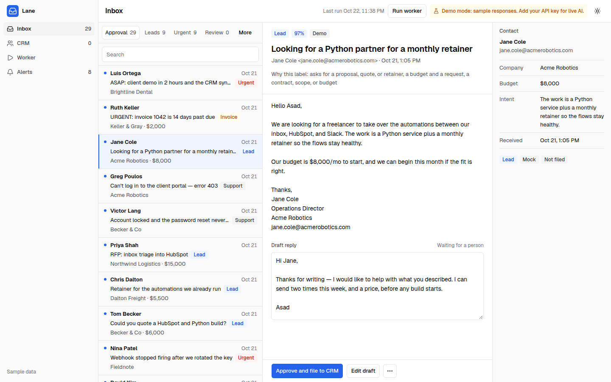
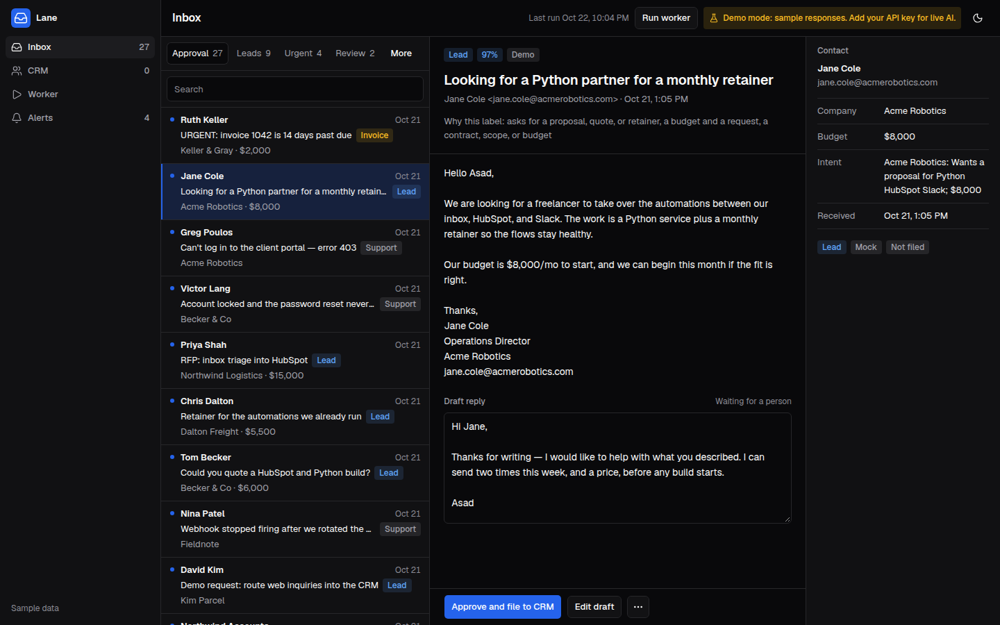
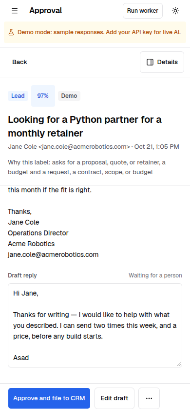
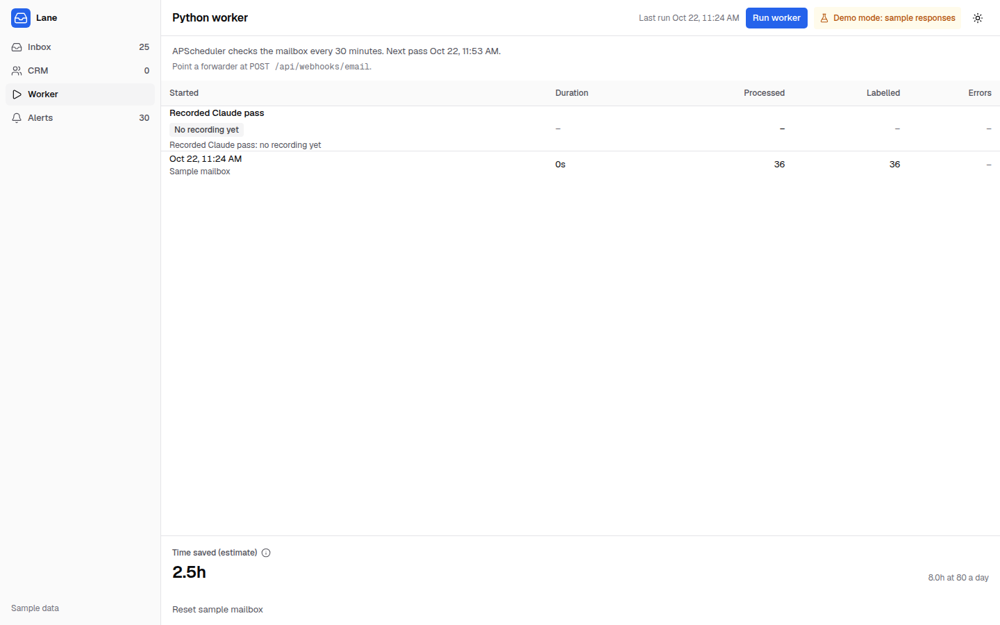
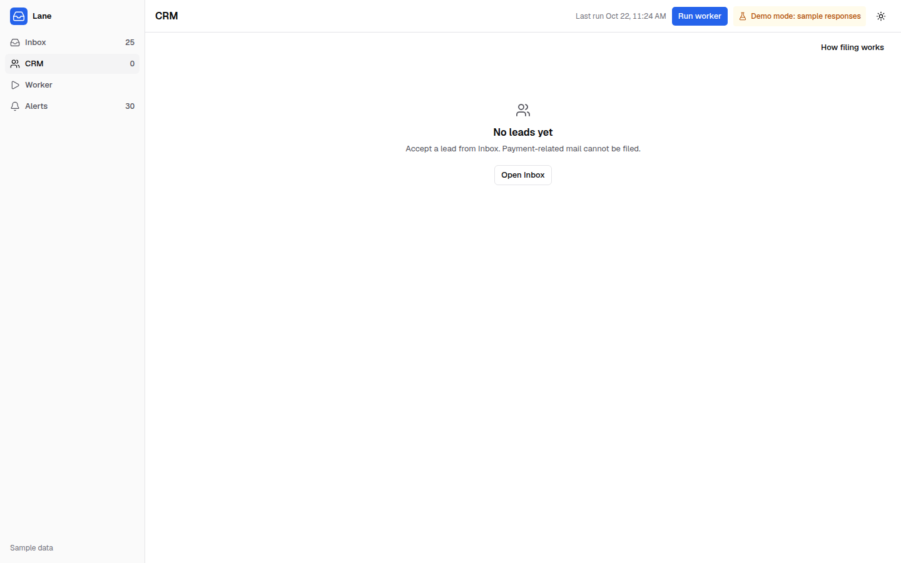
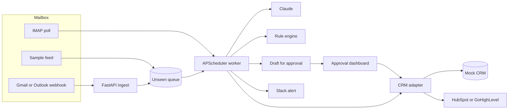

# AI Inbox Triage to CRM (Python + Claude)

Runs out of the box in Demo mode with sample responses; paste your own Anthropic or OpenAI key (never stored) to test the live AI.

Lane reads a client's inbox, classifies each message, and extracts the name, company, budget, and intent. It drafts a reply and stops. A person approves that draft and accepts the lead before anything is written to HubSpot or GoHighLevel. Demo mode uses the deterministic pipeline and sample wording. It does not call Claude or OpenAI. Live mode does, with the key you paste or with `ANTHROPIC_API_KEY` / `OPENAI_API_KEY` on a host you control.

The wait is the point. Sorting mail is cheap. Filing the wrong person, or paying the wrong account, is not. Approving a lead files it, and the server reads the original message again before that write. It refuses a suspicious row, a payee change, or a request to move money, including when the stored label says lead. A confirm or a block does not lock the reply, so the row is not stuck on "already approved". A second Accept after a successful file returns the lead that is already in the CRM. With no API key, the desk never files a lead on its own. With a key, Claude may file a lead, and only a lead, and only through that same gate. Payment mail is verified by phone.

On an 80-message morning, six minutes a message is about eight hours of skilled time spent sorting. The desk shows hours returned for the mailbox in front of you. The "8.0 hours" figure is that same rate on an assumed 80-message day. It is an assumption, not a measurement of a live inbox.

## Quick start

Docker Compose runs the API and the desk.

```bash
cp .env.example .env
docker compose up --build
```

Open [the desk](http://127.0.0.1:8742) and sign in with `lane-demo`. The sample `.env` sets `DEMO_MODE=true`, which is what allows the sample `API_TOKEN`, `WEBHOOK_SECRET`, and `DASHBOARD_PASSWORD` to boot. Compose publishes `127.0.0.1:8741` and `127.0.0.1:8742` only. For a client deployment, replace those three secrets and set `DEMO_MODE=false`.

Leave both model keys empty to click through in Demo mode. The desk badge reads "Demo mode: sample responses. Add your API key for live AI." Open **API key**, paste an Anthropic or OpenAI key, and the badge switches to "Live AI (Claude)" or "Live AI (OpenAI)". Your key is used only for this session and is never stored or logged. Send it in the `X-Lane-Key` header. The access log drops query strings, so a key placed on a URL is not written there either. We recommend rotating or revoking the key after testing. A rejected key, or one with no quota, falls back to Demo mode and says so. Self-hosting can still set `ANTHROPIC_API_KEY` or `OPENAI_API_KEY`. The Anthropic model defaults to `claude-sonnet-5-5`. The OpenAI model defaults to `gpt-4o-mini` and is changed with `OPENAI_MODEL`. This repo does not ship a recorded Claude pass. Until `demo/recorded_pass.json` exists, the desk shows **Recorded Claude pass: no recording yet**.

Without Docker, from Linux x86_64, Python 3.11, 3.12, or 3.13, and Node 20.9+:

```bash
python3 -m venv .venv
source .venv/bin/activate
pip install -r requirements.lock
pip install --no-deps -e ".[dev]"
cp .env.example .env
cp dashboard/.env.example dashboard/.env.local
pytest
uvicorn app.main:app --host 127.0.0.1 --port 8741
```

The first classification downloads `intfloat/multilingual-e5-small` revision `614241f622f53c4eeff9890bdc4f31cfecc418b3` and checks the sha256 of each file before it is used. The cache is `~/.cache/lane/e5`, or `$LANE_MODEL_DIR`. The base weights are about 470 MB. A fine-tune of the last eight encoder layers ships in `app/encoder_delta.npz` and is applied on top of that pinned download. Inference is PyTorch on CPU. Nothing in that file is sent to a paid model. `requirements.lock` pins `numpy==2.2.6` and `torch==2.14.1`, which publish manylinux wheels for CPython 3.11, 3.12, and 3.13 on Linux x86_64.

In another terminal: `cd dashboard && npm install && npm run dev`, then open http://127.0.0.1:8742. The browser talks only to the Next server. That server holds `API_TOKEN` and attaches it on the way to the API. Login sets an httpOnly cookie. Eight wrong passwords from one address pause login for ten minutes.

| Surface | URL |
| --- | --- |
| Dashboard | http://127.0.0.1:8742 |
| API docs | http://127.0.0.1:8741/docs |
| Ingest webhook | http://127.0.0.1:8741/api/webhooks/email |

## The desk

The inbox is a list and a reading pane. J and K move the selection. E or ⌘↵ approves the open message. ⌘K opens the command menu. Hours saved sit on the worker page as **Time saved (estimate)**.











## Scores

`pytest` prints these. **Measured in Demo mode**, on the deterministic pipeline. They are not a live Claude or OpenAI score. None of these files is a sealed holdout. A live model number is not included, because this repo has no recording.

| Set | Result |
| --- | --- |
| Dev mailbox, exact category (`data/sample_emails.json`, 44) | **40/44** |
| Same mailbox, counting spam filed as suspicious, and a first-contact urgent row left in review with suggested urgent | **41/44** (93.2%). The three misses are support notes called urgent: m14, m18, and m20. Urgent gold is **6/6**. |
| Name, company, and budget | **132/132**. Intent is the highest-scoring body sentence (the service, the scope, or the timing), clipped at 140 characters. It is not in this count. |
| `data/eval_fresh.json` (36, hash `6598554eb9358b571f08d994bd50a7e4be414182d697170927063f35ce6cf857`) | **36/36**. Structural phishing **7/7** suspicious. The hash stops later edits. It does not make the file unseen. |
| `data/eval_unseen.json` (68) | **62/68** (91.2%). Fields with a value **125/127**. Empty slots filled in **0/77**. The scorer counts suspicious as a hit when the gold label is spam. The file was written in the same pass as an earlier ruleset. Do not cite an older 68/68 figure. |
| `tests/new_emails_v2.py` (53) | Classification **42/53**. Urgent **6/6**. Phishing, fraud, and injection **9/9** suspicious. Legitimate mail flagged suspicious **1/39** (n14). Budget, where a value exists, **23/24**. Filled name, company, and budget slots **94/95**. Non-leads written to the CRM: **0**. |
| `tests/new_emails_v3.py` (45) | Classification **45/45**, where review is an accepted label for a low-confidence legitimate message. Urgent **3/3**. Phishing, fraud, and injection **16/16** suspicious, none written to the CRM. Legitimate mail flagged suspicious **0/27**. Budget **19/19**. Filled slots **66/67**. Non-leads written to the CRM: **0**. |
| Synthetic group fold 0 (`app/heldout_metrics.json`) | **319** rows held out of **2,069**. The split is by scenario group, so a typo, a signature, and a quoted copy stay in the same fold. This number is fold 0 only. It is not an average of five folds. Urgent recall **143/145** (98.6%) at false urgent **6/174** (3.4%), threshold **0.60**. Label accuracy **208/319** (65.2%). The linear head is fit on the other **1,710** rows. Forty paraphrase rows are used only to choose the epoch and are in neither fit. This split is synthetic. It is not a QA set. |
| Hand-written held-out (`data/hand_heldout.json`, 36) | Scored after training. Not used to fit the encoder, fit the head, or choose the threshold. It was committed in the same change as the weights, so history does not show it was written first. Urgent recall **12/12**. False urgent **3/24** (12.5%). Label accuracy **22/36** (61.1%). |
| Measurement set (`data/hand_heldout_r12.json`) | Paraphrase-disjoint from the corpus (no shared 6-word window). Committed before the round-12 rule changes. A later `measurement_set` key in `app/model_weights.json` is only a filename. It is not a retrain, and this file does not predate the numeric weights. Not used to fit or to choose the threshold. |
| Round-13 measurement set (`data/hand_heldout_r13.json`, 48) | Written and hashed in `7c4028f` before the round-13 rule change. Paraphrase-disjoint from the corpus and from both earlier hand sets. Not used to fit or to choose the threshold. On that set, after the rule change: phishing **16/16**, accept-with-confirm refuse **18/18**, direct CRM refuse **18/18**, lead category **15/15**, company **15/15**, budget **15/15**, name **15/15**, urgent recall **5/5**, false urgent **0**. |

An overdue invoice stays an invoice and also appears under Urgent. A calm invoice on the sender's own domain stays an invoice and is not suspicious. A suspicious message outranks both of those labels and does not appear under Urgent. A same-day legal or operational deadline is urgent, including from a first contact, and that sender is marked unverified. A commercial request or a recruiter note keeps its own label, with urgent only as a secondary when the head still fires after the sender and product name are removed. A note that already has both an organization and a project budget stays a lead, including in Spanish, German, Arabic, and Japanese. A project budget stays on the lead when a compensation figure is also present. A CJK or Arabic display name is the person. On v05 the company is the Japanese legal line in the signature, not the Latin gold name, so one company slot still misses. Demo mode still does not write a lead until a person approves it. Spam and suspicious rows can still show a From display name the gold file left empty. Those rows are not filed.

To score Claude on a set this repo was not tuned on:

```bash
python -m evals.live_claude --set path/to/messages.json
```

The command retries 429, 5xx, and Anthropic's 529. Cost is estimated from `config/model_prices.json`. Checked against Anthropic's pricing page on 2026-10-22, Claude Sonnet 5.5 is **$2 / million input tokens** and **$10 / million output tokens**. Cache hits are **$0.10** and the 5-minute cache write is **$2.50**. The figure is an estimate, not an invoice. The command refuses to run without `ANTHROPIC_API_KEY`.

To record a pass the desk can replay:

```bash
python -m evals.live_claude --record demo/recorded_pass.json
```

That reads `data/sample_emails.json`, calls Claude, and writes only the recording. It exits 2 and writes nothing when the key is missing. With `DEMO_MODE=true`, **Replay recorded pass** copies those rows onto the sample mailbox. The label is `Recorded Claude pass, <date>, <model>, sample mailbox`.

## Limitations

Demo mode scores phishing from features, not from a list of lure sentences. The structural features are language-independent: sender domain against the claimed organization, lookalike distance, free-mail, reply-to mismatch, link host against the sender, and first contact. A learned head scores the ask itself (money movement, a bank change, or a credential lure) in whatever language the note is written. An ask plus one of those structural features is suspicious. Suspicious is applied last, after every secondary label, and it strips Urgent, including the secondary urgent flag on an overdue invoice. It is not filed. A vendor invoice on the sender's own domain, including a footer that only prints a sort code, stays an invoice. Urgency is the learned head: an outage, a security or legal incident, or a same-day deadline with a consequence. The score is the max of the whole note and of each body sentence of at least 40 characters, so a greeting and a signature do not bury one line. The threshold **0.60** is the fold-0 point with the highest recall that still keeps false urgent at or below 5%. On that synthetic fold it is **143/145** recall and **6/174** false urgent. On the hand-written set, which did not pick the threshold, urgent recall is **12/12** and false urgent is **3/24**. A first-time urgent sender is marked unverified. Measured urgent on the v2 file is **6/6** and on the v3 file is **3/3**. An invoice that is past due stays an invoice and is also listed under Urgent, unless it is suspicious. A recruiter is not a lead, and a salary is not a budget. Amounts in 万元 and in AED (درهم) are read as budgets. The company comes from the signature, the domain, or an org line, not from the greeting. The CRM name comes from the From display name or the signature. Intent is one sentence from the body about the service, the scope, or the timing, at most 140 characters. Lane does not read images. A `cid:` part, and an image hosted on the sender's domain, do not by themselves require a confirm. A picture with no words, and a calendar invite, are not urgent.

Authentication is trusted only from the receiving mail server. `TRUSTED_AUTHSERV_ID` is that server's authserv-id, matched exactly: a suffix, a lookalike, a comment, or a zero-width character in the id does not count. The receiving server prepends its `Authentication-Results`. Lane reads Authentication-Results before `ARC-Authentication-Results`, whatever order the JSON keys arrived in, and uses only the topmost header whose id is in the list. `Authentication-Results-Original` is ignored. With the variable empty, which is the default, every sender is unauthenticated, including a header stored by a signed webhook. Once the variable is set, that webhook is trusted to forward the receiving server's headers faithfully and topmost-first. Microsoft 365 results often have no usable authserv-id, so those headers do not authenticate anyone. On the IMAP path the raw message is checked with DKIM: every signature is verified, and one aligned pass is enough. A message that was checked and did not pass is not authenticated by a header.

A second confirm, with the reasons on screen and a row in the filing log, is required when Accept would file a lead and any of these are true:

- The sender is not authenticated, and the message contains a shortened link, a punycode host, a link or image on some other domain, a link or image on the From domain, an inline `data:` image, a calendar invite, an attachment filename or `Content-Disposition: attachment`, or a brand/domain mismatch. SPF or DMARC alone does not authenticate.
- Any of these, whatever the domain and even when DKIM passes: the word QR or an image `src` or `alt` that says `qr` (including a `cid:` name that contains `qr`); "meeting starting"; a voicemail or a voice message; a mailbox quota or storage notice; an HTML form or a URL path for login or sign-in; a checkout link; a payment addendum; changed terms; an added CC to AP or accounts payable; a first statement of where invoices go, when nothing is being replaced.

A thread is trusted only when `In-Reply-To` or `References` names a Message-ID Lane has stored, the sender is a prior participant on that message, and DKIM passes aligned with From. A subject of `Re:` is not a thread. Checkout links, payment addenda, and changed terms inside a trusted thread still need the confirm.

These are phone-blocked. Confirm does not file them:

- Polite payee changes, store cards, claim codes, wallets, and crypto. They are not reliably marked suspicious.
- A real payment detail, or a change of an existing one. A valid IBAN is cut at the country length, so the following word is not part of the checksum. A BIC or SWIFT code written next to that label, a US account number beside an ABA routing number, or a UK sort code beside an account number. A note that the bank or institution changed, in English, German, French, Spanish, Portuguese, Arabic, Chinese, Japanese, or romanized Urdu or Hindi. That change is suspicious, not only a review row. A request to route or send the payment to the account in an attached letter. Asking to pay a first contact, or to change where a payment goes, by Zelle, Venmo, Cash App, or a PayPal.me link. Factoring taking over payment, an ACH enrollment or authorization form, a lockbox change, and account details left in an enclosed notice. Replacing a billing mailbox ("instead", "new billing email", "update the AP contact") is the same block. Confirm does not file any of these.
- The filing gate re-runs the suspicious decision. A forced lead label does not drop it. Confirm may clear a generic unknown-domain or shortener banner on ordinary mail. It does not write a payment ask from free mail, or a payment ask behind a shortener, that the scorer calls suspicious. A credential link on a private domain the sender does not own is suspicious on the stateless route, and it is not urgent.
- A new client who only says where invoices go ("our AP address is") is the soft confirm above, and so is "please also cc our AP", including when the note says the bank details are unchanged. A payout already on its way to a bank account is not this banner. A receipt or a notification from Zelle, Venmo, Cash App, or PayPal is not this banner. "We paid the invoice via ACH" is not this banner. A vendor invoice whose footer only prints a sort code and an account number stays an invoice. Filing that invoice as a lead still shows the phone banner. It is not marked suspicious.
- A row already marked suspicious, including when its stored flags are empty. `POST /api/triage` cannot clear that label, and it cannot create a lead label on a message the server reads as phishing. `POST /api/crm/leads` runs this same gate for every category. A write with no stored message is refused.

These still get through as ordinary mail unless they also trip a rule above:

- A cousin domain more than two edits from every known contact and every known brand, with no homoglyph and no subdomain trick. Two edits, a homoglyph, or a brand tucked under another registrable domain, plus a request to move money, is suspicious.
- A reply that quotes a real thread and then asks for ordinary work, with no new link and no stored Message-ID to check.
- Calendar invites are not parsed. The confirm reason is the text "calendar invite", not the event.
- A sentence the urgency head scores under 0.60. The head is trained on synthetic mail in English, German, French, Spanish, Portuguese, Arabic, Chinese, and romanized Urdu and Hindi, with more than one wording per scenario. Those rows are not copies of the eval files, the sample mailbox, or the hand-written held-out set. Fold 0 urgent recall is 143/145 at 6/174 false urgent. The hand-written set is 12/12 urgent and 3/24 false urgent. On the dev mailbox, m14, m18, and m20 are support notes the head calls urgent.
- Instructions a person can read in the normal text. Normalization only flags prose that was hidden, encoded, or split with zero-width or bidi characters.
- A picture that does not say QR. Lane cannot see a code drawn in an image. If the text, the file name, the `src`, and the `alt` never contain `qr`, the image is one click. A logo is left alone on purpose.
- A payout, disbursement, or preference line that never names a rail, a payee, an account, a wallet, or a change of where invoices or payments go. "Our payout preference is the Friday batch" is ordinary mail. A paystub or a "funds available" notice is the same shape, so a fooled model can auto-file one. The rules demo never auto-files.
- A bank-change note that never names a bank or institution. A bare "account" in Spanish or French (`cuenta`, `compte`), with no bank word, is ordinary mail.
- A note that an old account will bounce, that payment should wait until a pay-to is updated, or that the numbers are on another page, when it names no bank, rail, form, lockbox, or real account number.
- A sort code written as digits with no hyphens.

The phishing decision is that feature score, not a longer list of sentences. Claude is the live classifier. A person accepts the lead. Payment mail is verified by phone.

## How the pipeline works

1. Mail arrives on `POST /api/webhooks/email`, or the worker polls IMAP for anything unseen. The demo uses a labeled sample feed instead of a live mailbox.
2. The message is normalized before any rule runs: zero-width and bidi characters are stripped, off-screen and hidden HTML is dropped, and base64, quoted-printable, and HTML-entity runs are decoded. Concealed prose is flagged.
3. Demo mode, or live Claude / OpenAI when a key is present, suggests **lead, support, invoice, spam, urgent, suspicious, recruiter, or needs review**, and extracts **name, company, budget, and intent**. Intent is the body sentence that best states the service, the scope, or the timing. It is not the subject and it is not a fixed template. Invoice is used when the message has an amount due, an invoice number, a receipt, or a payment request. A contract or a statement of work with a budget stays a lead. Category scores are regular expressions. When they are unsure (nothing at 4 or above), a head on `intfloat/multilingual-e5-small` picks the label. The classifier is not embedding-only. Urgency is a separate head on a fine-tune of that model's upper layers. A same-day legal or operational deadline is a closed class, so it is urgent even when the wording is not an outage. A token that only appears inside the sender or product name does not clear the urgency threshold. The heads are trained on synthetic mail grouped by scenario. They are not trained on the eval files, the sample mailbox, or either hand-written held-out set. The rank rule runs last: suspicious replaces every other label and is removed from Urgent, including a secondary urgent flag. A past-due invoice stays an invoice and is also urgent, unless the message is suspicious. Opt-out, receipt, and lottery or token spam are recognized beyond one English word. A support note that says it is not urgent stays support. **Filed to CRM** quotes the lead summary, not the draft. Demo replies are sample wording from that pipeline. They are not labeled as Claude or GPT.
4. It writes a draft. It does not send it.
5. Nothing reaches the CRM until the filing gate says yes. A sender is authenticated only when `TRUSTED_AUTHSERV_ID` is set and the topmost Authentication-Results header from that exact id says `dkim=pass` aligned with From, or when a local DKIM check on the raw message finds an aligned signature. The variable is empty by default, and then every sender is a first contact. A subject of "Re:" is not a thread. Approving a lead is the write: **Approve and file to CRM**. The gate still runs on that click.
6. A person edits the draft if they want and approves it. Spam is stored and not announced. Approving a suspicious message archives it and does not post a "Reply approved" alert. Alerts are raised for urgent mail, suspicious mail, a lead that was just filed, and a reply that was just approved on anything else. Ordinary support and invoices do not each create an alert. The stored alert text is plain. Slack's mrkdwn escaping happens only on the webhook payload.



Hours returned are counted at six minutes a message. Spam, suspicious, and needs-review mail are left out of that count.

- **Webhook ingest.** `POST /api/webhooks/email` queues one message. The body must carry `X-Lane-Signature: sha256=<hmac of the raw body>` using `WEBHOOK_SECRET`. The same message returns `duplicate` instead of queueing a second copy.
- **Scheduler.** APScheduler polls on `WORKER_INTERVAL_SECONDS` (60 by default). The Worker page shows the next run. For a screenshot session, set it to `1800` so the sample queue stays put until you press Run worker.
- **Mock mailbox.** Forty-four labeled messages stand in for IMAP. Eight stay unseen so Run worker has something to do.
- **CRM adapter.** Set `HUBSPOT_TOKEN` and an accepted contact is upserted by email. Lane creates the contact properties `lane_budget` and `lane_intent`. If the portal rejects them, the budget and intent go into a note associated with that contact. Set `GHL_API_KEY` and `GHL_LOCATION_ID` and GoHighLevel upserts the contact with those two custom fields, or puts the same text on `source` if the location rejects custom fields. A remote failure is stored on the lead and shown in the CRM table.
- **Mock Slack.** Alerts render in the dashboard. `SLACK_WEBHOOK_URL` also posts them.
- **Approve or edit.** The draft is a textarea. Approving a lead files it, then marks the reply approved. Nothing is emailed until a sender is connected.

## Connecting a client's stack

**Gmail.** A short Apps Script or a Workspace routing rule posts each new message as JSON to `/api/webhooks/email` (`from_name`, `from_email`, `subject`, `body`, `message_id`). If the client would rather not run a hook, set `IMAP_HOST=imap.gmail.com` with an app password. The worker's poll reads UNSEEN and uses the same classify path. With neither set, Lane reads the sample feed.

**Outlook.** Power Automate, or a small Graph subscription, posts the same JSON to the webhook when mail hits a shared mailbox. Many Microsoft 365 tenants block basic IMAP, so the webhook is the path to prefer. IMAP (`outlook.office365.com`) still works for tenants that allow it.

**HubSpot.** The private app token needs `crm.objects.contacts.write` and `crm.schemas.contacts.write`.

| Property | Label | Type |
| --- | --- | --- |
| `lane_budget` | Lane budget | single-line text |
| `lane_intent` | Lane intent | single-line text |

Both sit in the `contactinformation` group. If the portal still rejects the properties, Lane upserts the standard fields and writes the budget and intent as a note. The mock row stays either way.

**GoHighLevel.** The adapter upserts the contact and sends `lane_budget` and `lane_intent` as custom fields. If the location returns 400, it retries without those fields and puts the same text on `source`.

**Slack.** Set `SLACK_WEBHOOK_URL`. The alert text is the same string the dashboard already shows.

**Sending the approved reply.** The desk stops at approval on purpose. The usual follow-on is a Gmail or Outlook draft, not a send, created when someone approves. That keeps a person in the loop.

Webhook body:

```json
{
  "from_name": "Jane Cole",
  "from_email": "jane.cole@acmerobotics.com",
  "subject": "Looking for a Python partner for a monthly retainer",
  "body": "We are looking for a freelancer. Budget is $8,000/mo.",
  "message_id": "gmail-18f3"
}
```

## Layout

| Path | What it is |
| --- | --- |
| `app/main.py` | FastAPI ingest, classification, approval |
| `app/worker.py` | APScheduler loop |
| `app/classifier.py` | Regex category scores, plus embedding heads that fill a gap and score urgency |
| `app/embedder.py` | Pinned `multilingual-e5-small` revision, sha256 checks, CPU PyTorch, fine-tune delta |
| `app/encoder_delta.npz` | Fine-tune of the last eight encoder layers |
| `app/heads.py` | Trained label, urgency, and ask heads (`app/model_weights.json`) |
| `data/hand_heldout.json` | 36 hand-written emails scored after training. Same commit as the weights |
| `data/hand_heldout_r12.json` | Round-12 measurement set. The later filename stamp is not a retrain |
| `data/hand_heldout_r13.json` | Round-13 measurement set, hashed before the rule change |
| `app/risk_score.py` | Feature phishing score. Money-movement plus a risky sender or a link mismatch is suspicious |
| `app/rank.py` | The one place suspicious outranks every label and is never urgent |
| `app/offline.py` | Retired hashed n-gram. Not on the classify path |
| `app/llm.py` | Claude (`claude-sonnet-5-5`), then OpenAI, with a logged rules fallback |
| `app/risk.py` | Structural phishing, fraud, and injection checks |
| `scripts/train_heads.py` | Retrains the heads from `app/corpus.py` and writes `app/heldout_metrics.json` |
| `app/gate.py` | The server filing gate |
| `app/crm.py` | Mock, HubSpot, and GoHighLevel upserts |
| `data/sample_emails.json` | 44 dev messages |
| `data/eval_unseen.json` | 68 messages from an earlier pass. Not a fresh set |
| `data/eval_fresh.json` | 36-message regression file. Not unseen |
| `ci/github-actions-ci.yml` | GitHub Actions workflow (kept outside `.github/workflows`) |
| `tests/` | Accuracy, security, webhook, and CRM tests |
| `dashboard/` | Next.js approval desk |
| `docker-compose.yml` | API and dashboard |

## Portfolio line

**Title:** AI Inbox Triage to CRM (Python + Claude)

**Description:** I build a Python service that reads a client's inbox and classifies each message with Claude, pulling out the name, company, budget, and intent. A person approves the draft, and approving a lead writes it to HubSpot or GoHighLevel through a filing gate. With no key, a ruleset plus a local multilingual embedding model does the same job and does not file on its own. Claude is the product.

**Tags:** Python, Claude, AI Automation, HubSpot, FastAPI
